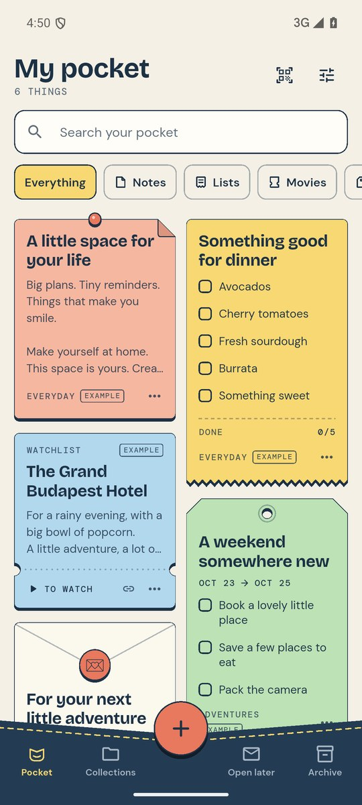
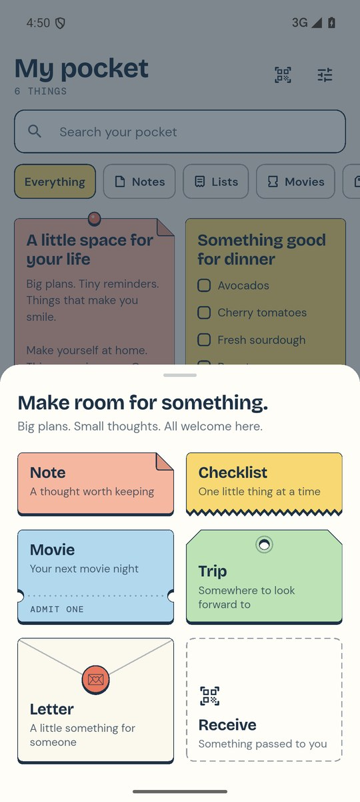
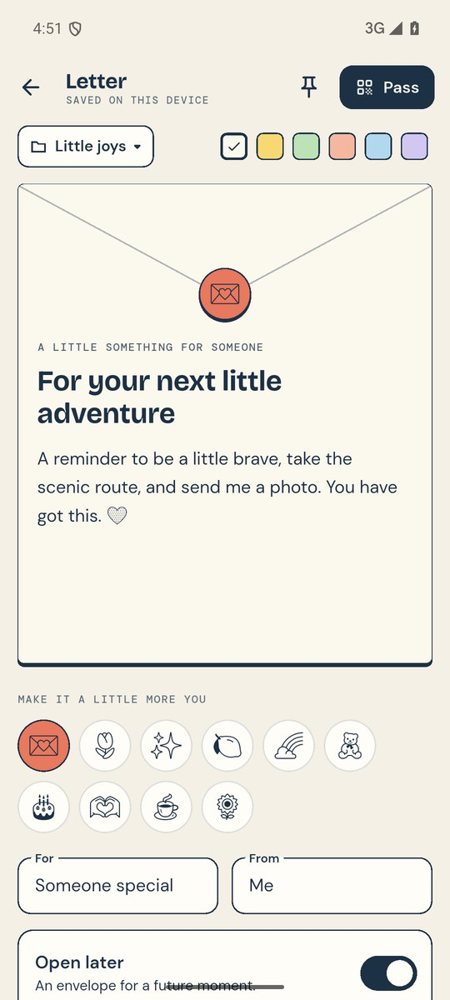
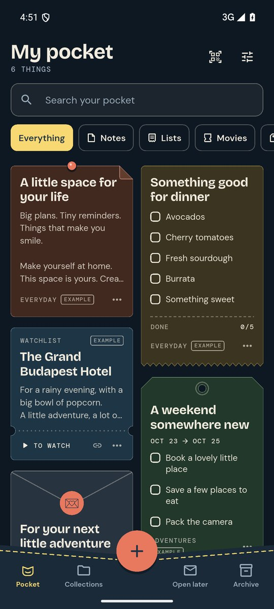
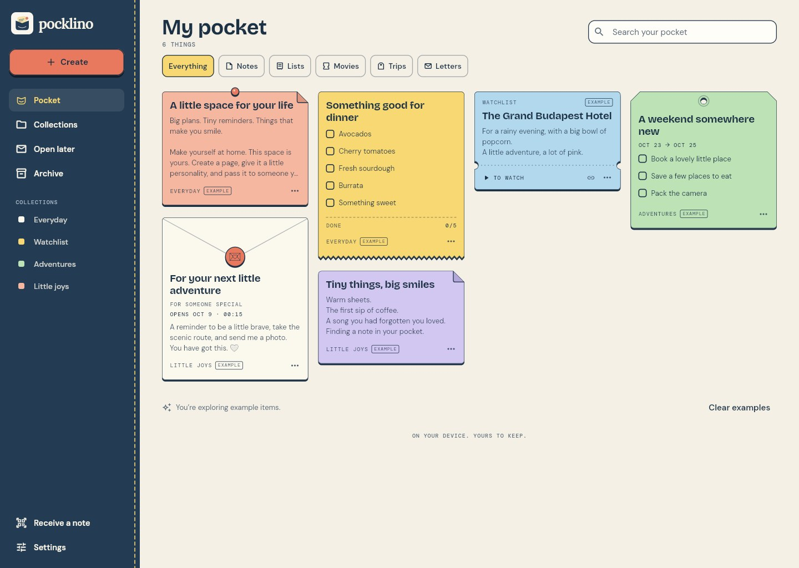

# Pocklino

**A little space for your life.**

Pocklino is a small notebook for thoughts, groceries, films, trips and little surprises. Every kind of page is its own paper: a note is a slip, a list is a receipt, a film is a cinema ticket, a trip is a luggage tag and a letter is an envelope. They all live in one stitched pocket.

Everything stays on your device. There is no account and no Pocklino server, and the app adds no analytics or advertising. To give someone a page you pass them a copy, by QR code or as a file.

Pocklino is a hobby project by Glenn Höglund at [goodjob.nu](https://goodjob.nu), built with Flutter for Android, Windows and the web.

## Screenshots

<table>
  <tr>
    <td align="center" width="25%"></td>
    <td align="center" width="25%"></td>
    <td align="center" width="25%"></td>
    <td align="center" width="25%"></td>
  </tr>
  <tr>
    <td align="center">The pocket</td>
    <td align="center">Something new</td>
    <td align="center">A letter</td>
    <td align="center">Evening</td>
  </tr>
</table>



The phone pictures are from version 1.0.0 on an Android 15 emulator, the wide one from the web build in Chrome. [View all screenshots](docs/screenshots).

## Features

- **Five kinds of page:** notes, checklists, movies, trips and letters, each with its own paper, color and sticker.
- **Checklists that last:** tick items from the card, see finished ones grouped below, and reset or duplicate a list to use it again.
- **Movies and trips:** a movie keeps a link and a watched switch; a trip keeps dates, plans and a packing list.
- **Letters for later:** write to someone, and choose **Open later** to keep the envelope sealed until a date and time.
- **Pass a copy:** show one QR code, an animated series of codes for longer pages, a copied code or a `.pocklino` file. The receiver sees a preview before keeping it.
- **Order when you want it:** collections, pinning, search, filters by kind and an archive.
- **Day and evening:** a light and a dark look, or follow the device.
- **Yours to keep:** autosave on the device and a readable backup file you can export and restore.

Passing makes an independent copy; nothing syncs afterwards. Open later is a friendly surprise based on the receiving device's clock, not a lock: the content is not encrypted, and the title and opening time stay visible. Movie details are typed by you; a link opens in your browser. There are no reminders or notifications.

## Get the app

**Android:** download the newest `pocklino-<version>.apk` from the [Releases page](https://github.com/goodjobswe/pocklino/releases) and open it on the phone. Android asks once to allow installs from that source. It needs Android 6.0 or newer. The app is not on Google Play.

**Windows:** download `pocklino-<version>-windows.zip` from the same page, extract the whole archive and run `pocklino.exe`. Keep the files next to it. The app is not code signed, so Windows may show a warning the first time; choose **More info** and **Run anyway**. Windows has no camera scanning: receive a page by file or by pasting its code.

**iOS:** no build is published. The native project is included but has not been built yet.

**Web:** there is no hosted copy. Build it from source as described below.

Each release also carries a `.sha256` checksum for every file.

## Your data

Notes are stored in a local database on the device: a file in the app's own storage on Android, the file `pocklino-v1.db` in your Documents folder on Windows, and IndexedDB in the browser. There is no account and so no recovery through one. Export a backup from Settings before you move to a new device or remove the app; uninstalling or clearing site data removes the notes.

- A backup is a readable JSON file of up to 10 MB. Restoring checks the whole file first, skips exact duplicates and keeps conflicting versions as separate pages.
- One passed page can hold up to 64 KiB. Long pages need many QR frames, so a file is easier.
- The Android release has no internet permission at all. Links open in the browser.
- Pocklino never uploads anything by itself. If you send a file through a messaging or cloud app, that service handles it.
- The database and the exported files are not encrypted.

## Run locally

The tested baseline is **Flutter 3.29.3 / Dart 3.7.2**.

```sh
git clone https://github.com/goodjobswe/pocklino.git
cd pocklino
flutter pub get
flutter run -d chrome
```

Use `flutter devices` to list other targets, such as an Android phone or emulator, and `flutter run -d windows` for the desktop app, which needs the Visual Studio desktop C++ workload. See the [development guide](docs/DEVELOPMENT.md) for release builds, signing and the Windows build script.

A new pocket starts empty. Choose **Take a peek at an example pocket** to look around; the examples can be removed again in Settings.

## Project status

Version 1.0.0 is the first release. It passes static analysis and its automated tests, and these checks were made by hand on October 2, 2026:

| Platform | Status |
| --- | --- |
| Android | The signed release build was walked through on an Android 15 emulator: empty pocket, examples, creating and editing, collections and both looks. Scanning a code with a real camera between two phones has not been tested yet. |
| Windows | The release build starts and draws its window. File dialogs and a clean machine have not been tested. |
| Web | The release build was checked in Chrome: saving survives a reload, the app decodes its own rendered QR code, and a second browser receives a page. No outside network requests. |
| iOS | Native project included; build and testing still needed on a Mac with Xcode. |

The [verification checklist](docs/QA.md) lists what the tests cover and what remains to check on real devices.

## Development

Run the checks with:

```sh
dart format --output=none --set-exit-if-changed lib test tool
flutter analyze
flutter test
```

The same checks, a web build and a debug APK build run in GitHub Actions for every push and pull request. The tests cover the data model, storage and backup, the transfer format, and the main flows of the interface.

The main parts of the code are:

- `lib/design.dart` - the day and evening palettes, themes and type.
- `lib/paper.dart` - the paper shapes and the small parts drawn on them.
- `lib/pocket.dart` - the pocket bar, the side panel and the create button.
- `lib/home.dart`, `lib/editor.dart`, `lib/sharing.dart`, `lib/settings.dart` - the screens.
- `lib/models.dart`, `lib/store.dart`, `lib/storage/` - pages, the notebook and its local database.
- `lib/transfer.dart` - the format for passing a page, with QR frames and checksums.
- `android/`, `ios/`, `web/`, `windows/` - the platform projects.

More detail:

- [Development guide](docs/DEVELOPMENT.md) - builds, signing, releasing and the screenshot tool.
- [Architecture and transfer format](docs/ARCHITECTURE.md)
- [Brand guide](docs/BRAND.md) - the design language, colors and type.
- [Verification checklist](docs/QA.md)

## Contributing

Issues and pull requests are welcome. For a bug report, include the device and OS, the app version from Settings, the steps to reproduce, and what you expected. A screenshot helps for layout problems. For a pull request, run the checks above first.

## Credits

The fonts are Bricolage Grotesque, DM Sans, DM Mono, Lora, Roboto and Noto Emoji under the Open Font License; their notices are in [assets/fonts](assets/fonts). The web build reads QR codes with ZXing under the Apache License 2.0, included in [web/assets](web/assets). The app shows these and the licenses of its Flutter packages under Settings, Open-source licenses.

## License

The source code is released under the [MIT License](LICENSE), so anyone can learn from it or build on it. The license covers the code only: the name Pocklino, the logo, the mark and the app icon in [assets/brand](assets/brand) are not included and may not be used for another app or product without permission.
